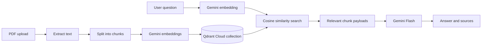

# DocuMind

DocuMind is a PDF RAG assistant using Gemini for embeddings and answers, and Qdrant Cloud for persistent vector search.

## Architecture



## Technology

- Node.js and Express.js
- CommonJS JavaScript
- Google Gemini SDK
- `@qdrant/js-client-rest`
- Qdrant Cloud
- Multer and pdf-parse
- HTML, CSS, and vanilla JavaScript

## Qdrant Cloud Setup

1. Create a Qdrant Cloud cluster.
2. Copy the HTTPS cluster URL, for example `https://example-region.cloud.qdrant.io`.
3. Create or copy a cluster API key.
4. Copy `.env.example` to `.env`.
5. Configure:

```text
QDRANT_URL=https://your-cluster.example.cloud.qdrant.io
QDRANT_API_KEY=your_qdrant_api_key
QDRANT_COLLECTION=documind_documents
```

The Node.js backend sends credentials directly to Qdrant. Never place Qdrant credentials in frontend JavaScript or commit `.env`.

No local Qdrant container or Docker service is required.

## Gemini Setup

```text
GEMINI_API_KEY=your_gemini_api_key
GEMINI_GENERATION_MODEL=gemini-flash-lite-latest
GEMINI_EMBEDDING_MODEL=gemini-embedding-001
```

## Environment

```text
PORT=5000
GEMINI_API_KEY=
GEMINI_GENERATION_MODEL=gemini-flash-lite-latest
GEMINI_EMBEDDING_MODEL=gemini-embedding-001

QDRANT_URL=
QDRANT_API_KEY=
QDRANT_COLLECTION=documind_documents

CHUNK_SIZE=1000
CHUNK_OVERLAP=200
TOP_K=5
CHAT_HISTORY_WINDOW=12
MAX_UPLOAD_MB=10
RATE_LIMIT_WINDOW_MS=900000
RATE_LIMIT_MAX=100
```

## Qdrant Collections and Vectors

DocuMind initializes `documind_documents` only when needed. Each document chunk is upserted as a point with:

- UUID point ID derived from document ID and chunk index
- Gemini embedding vector
- `documentId` payload
- `filename` payload
- `text` payload
- `chunkIndex` payload
- `pageNumber` payload
- `uploadTimestamp` payload

The collection uses Cosine distance. Its vector dimension is obtained from the actual Gemini embeddings and is compared with existing collection configuration. A mismatch is reported without deleting or recreating the collection.

## Search and Document Filtering

Gemini embeds each question. Qdrant performs cosine similarity search and optionally filters points by one or multiple `documentId` payload values. Search results include text, metadata, and a similarity score.

## Install and Run

```bash
npm install
cp .env.example .env
npm start
```

Open `http://localhost:5000`.

Development mode:

```bash
npm run dev
```

Docker is not required for Qdrant Cloud.

## API

- `POST /api/documents/upload`
- `GET /api/documents`
- `GET /api/documents/:id`
- `DELETE /api/documents/:id`
- `POST /api/chat`
- `GET /api/chat/:conversationId`
- `GET /api/health`

## Tests

```bash
npm test
npm run test:qdrant
```

Unit tests mock external services. The Qdrant integration test is skipped unless Qdrant credentials are configured and performs a read-only connectivity/status check.

## Common Qdrant Errors

- Missing credentials: set `QDRANT_URL` and `QDRANT_API_KEY`.
- Invalid API key: create a valid cluster API key and restart the server.
- Wrong endpoint: use the cluster HTTPS URL without `/localhost` or `/6333`.
- Dimension mismatch: keep the configured embedding model or migrate existing vectors deliberately.
- Network timeout: verify network access and the cluster status.
- Collection unavailable: verify cluster permissions and collection name.

## Limitations

- Conversation history and application document metadata are in memory.
- OCR is not included.
- Authentication and persistent application metadata are not included.
